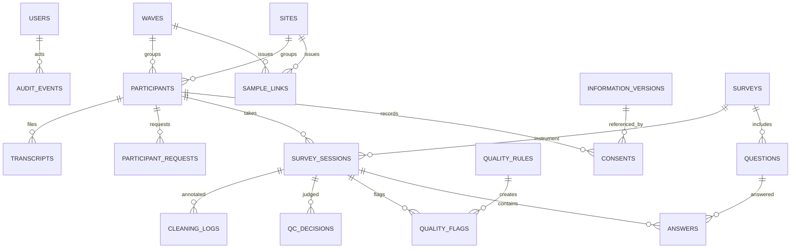

# ERD, data dictionary tóm lược

| Table | Mục đích chính | Khóa/quan hệ/kiểm soát |
|---|---|---|
| `users` | Người quản trị và role | Email unique, password hash, role allowlist |
| `sites`, `waves` | Mã cơ sở/đợt (không công bố tên) | `code` unique |
| `sample_links` | Registry QR/link có token ngẫu nhiên | `site_id`, `wave_id`, `group_code`, `token` unique, active false mặc định |
| `quota_configs` | Quota phiên bản và duyệt | `site_id`, `wave_id`, nhóm, target, approved_by |
| `information_versions` | Bản thông tin tham gia được duyệt | Version, mục đích/hoạt động/thời lượng/quyền rút lui/dữ liệu |
| `surveys`, `questions` | Bảng hỏi theo nhóm và phiên bản | survey group/version unique, question survey/code unique, condition JSON |
| `participants` | Research ID và nhóm/site/wave | UUID unique không suy ra họ tên |
| `consents` | Chứng cứ đồng thuận tối thiểu | participant + thông tin version + decision + timestamp |
| `survey_sessions` | Lần trả lời + resume token | participant/survey foreign keys; trạng thái draft/complete |
| `answers` | Dữ liệu raw trong JSON đơn giản | survey_session/question unique; khóa tại controller sau complete |
| `quality_rules`, `quality_flags` | Định nghĩa cờ và dấu hiệu | phê duyệt trước áp dụng, evidence kỹ thuật |
| `qc_decisions` | Quyết định Valid/Review/Exclude | lý do/người duyệt/thời điểm; giữ lịch sử |
| `participant_requests` | Hỗ trợ/rút lui | yêu cầu/giải quyết, không xóa tự động |
| `cleaning_logs` | Audit bước làm sạch chú giải | session, before/after, reason, actor |
| `export_runs` | Snapshot export | format/scope/rows/SHA-256 |
| `transcripts` | Registry file âm thanh + bản chép | Research ID qua participant; file private |
| `audit_events` | Nhật ký quản trị tối thiểu | actor, action, entity, metadata không chứa answers |

## Nguyên tắc dữ liệu

- Không có cột MSSV, họ tên thật, địa chỉ nhà, số điện thoại, email người tham gia trong schema khảo sát.
- `sites.private_label` là ghi chú nội bộ, không đưa vào dataset hoặc QR.
- `resume_token` là bí mật truy cập cá nhân kiểu bearer link; **không chia sẻ công khai**. Nên tăng bảo vệ nếu triển khai internet/nhóm nguy cơ cao.
- Trong export, biến phân tích đặt theo `Q{survey_id}_{code}` để không gộp nhầm 2 version; codebook phải duy trì nhất quán qua version.
- Thay đổi dữ liệu phân tích cần ghi cleaning log và pipeline được NCS chốt; bản raw không sửa/không xóa ngầm.
